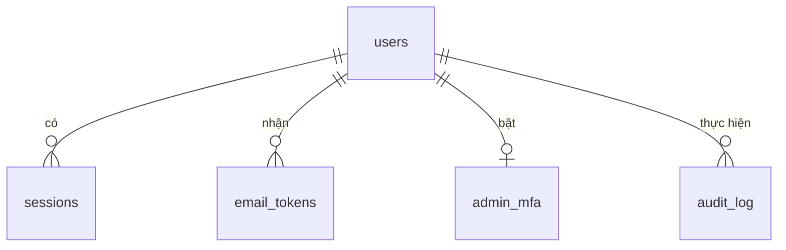

# Module Auth

> Trạng thái: **nháp**, chờ review. Các ngưỡng (10 ký tự, 5 lần sai, 30 phút) là ví dụ; nên đối chiếu với hướng dẫn bảo mật hiện hành như OWASP ASVS trước khi chốt.

- **Vai trò:** Đăng ký, xác minh email, đăng nhập, đăng xuất, quên mật khẩu, quản lý phiên, phân quyền khách và admin, gắn đơn vãng lai vào tài khoản.
- **Domain (ví dụ shop quà tặng):** Generic: dùng thư viện xác thực có sẵn, không tự chế.
- **Phụ thuộc:** Không chặn Order ([ADR 0002](../../decisions/0002-guest-checkout.md)). Gọi Catalog để gộp giỏ, gọi Notify để gửi email xác minh và đặt lại mật khẩu. Mọi API admin dựa vào vai trò do Auth cấp.

## 1. Yêu cầu nghiệp vụ và acceptance criteria

### Ai dùng

| Ai | Muốn | Để |
|---|---|---|
| Khách đã mua một lần | Tạo tài khoản sau khi mua | Xem lại mọi đơn ở một chỗ |
| Khách | Đăng nhập, đăng xuất, đặt lại mật khẩu | Dùng tài khoản an toàn |
| Admin | Đăng nhập với bảo vệ mạnh hơn | Quản lý shop mà không lo bị chiếm tài khoản |

### Acceptance criteria

1. **Khi** đăng ký bằng email và mật khẩu từ 10 ký tự trở lên, không nằm trong danh sách mật khẩu phổ biến hoặc đã bị lộ, **thì** tạo tài khoản chưa xác minh và gửi email xác minh.
2. **Khi** đăng ký bằng email đã có tài khoản, **thì** phản hồi giống hệt trường hợp thành công; chủ email nhận thư báo "bạn đã có tài khoản". Không ai dò được email nào đã đăng ký.
3. **Khi** đăng nhập sai, **thì** thông báo chung "Email hoặc mật khẩu không đúng".
4. **Khi** một tài khoản bị nhập sai 5 lần trong 15 phút, **thì** tạm dừng đăng nhập vào tài khoản đó 15 phút. Mỗi IP cũng bị giới hạn số lần thử.
5. **Khi** đăng nhập thành công, **thì** tạo phiên mới: hết hạn sau 7 ngày không dùng, tối đa 30 ngày. Phiên admin tối đa 8 giờ.
6. **Khi** quên mật khẩu, **thì** nhận đường dẫn dùng một lần, hết hạn sau 30 phút. Đặt mật khẩu mới xong thì mọi phiên khác bị đăng xuất.
7. **Khi** xác minh email xong, **thì** các đơn vãng lai có cùng email được gắn vào tài khoản. Chưa xác minh thì không gắn.
8. **Khi** đăng xuất, **thì** phiên bị thu hồi ở server ngay lập tức.
9. **Khi** admin đăng nhập, **thì** bắt buộc mã xác thực hai lớp (TOTP).
10. **Khi** khách vãng lai đăng nhập, **thì** giỏ của phiên được gộp vào giỏ tài khoản.

### Giao diện

| Trạng thái | Hiển thị |
|---|---|
| Đang gửi | Khóa nút, không cho gửi hai lần |
| Lỗi | Thông báo chung, không nói email có tồn tại hay không |
| Tạm khóa | "Thử lại sau 15 phút", kèm đường dẫn đặt lại mật khẩu |
| Đã gửi email | "Nếu email hợp lệ, bạn sẽ nhận được thư trong vài phút" |

**Accessibility và trình quản lý mật khẩu:** mọi ô có nhãn; dùng `autocomplete="email"`, `current-password`, `new-password` để trình quản lý mật khẩu hoạt động; có nút hiện hoặc ẩn mật khẩu; lỗi được đọc qua `aria-live`; không chặn dán mật khẩu.

### Ngoài phạm vi

Đăng nhập bằng Google hoặc Facebook, đăng nhập bằng số điện thoại và mã OTP, passkey, phân quyền chi tiết hơn hai vai trò. Mỗi thứ khi thêm cần một ADR.

## 2. Phân loại domain

**Generic.** Khách không chọn shop vì cách đăng nhập. Hai lựa chọn hợp lý:

| Lựa chọn | Hợp khi |
|---|---|
| Thư viện xác thực của framework, phiên lưu ở server | Một ứng dụng, cần kiểm soát dữ liệu, chưa cần đăng nhập mạng xã hội |
| Dịch vụ quản lý danh tính bên ngoài | Cần đăng nhập mạng xã hội, đăng nhập một lần cho nhiều ứng dụng, hoặc không muốn tự vận hành |

Case study chọn lựa chọn đầu, đề xuất trong [ADR 0006](../../decisions/0006-phien-dang-nhap-luu-o-server.md).

Generic không có nghĩa là dễ: sai ở Auth là lộ dữ liệu của mọi khách hàng. Không tự viết thuật toán băm mật khẩu, sinh mã hay mã hóa.

## 3. Mô hình dữ liệu

### users

| Cột | Kiểu | Ràng buộc, ghi chú |
|---|---|---|
| `id` | text | PK, `usr_` + chuỗi ngẫu nhiên |
| `email` | text | UQ, lưu dạng chữ thường |
| `email_verified_at` | timestamptz | Rỗng khi chưa xác minh |
| `password_hash` | text | Băm bằng thuật toán chậm chuyên cho mật khẩu (như Argon2id hoặc bcrypt) qua thư viện |
| `role` | text | `customer` hoặc `admin` |
| `status` | text | `active`, `disabled` |
| `created_at`, `last_login_at` | timestamptz | |

### Các bảng còn lại

| Bảng | Cột chính | Ghi chú |
|---|---|---|
| `sessions` | `id_hash`, `user_id`, `created_at`, `last_seen_at`, `expires_at`, `revoked_at`, `ip`, `user_agent` | Chỉ lưu bản băm của mã phiên |
| `email_tokens` | `token_hash`, `user_id`, `purpose` (`verify`, `reset`), `expires_at`, `used_at` | Dùng một lần |
| `login_attempts` | `email_hash`, `ip`, `attempted_at`, `success` | Dùng cho giới hạn số lần thử; xóa sau 30 ngày |
| `admin_mfa` | `user_id`, `secret_encrypted`, `enabled_at`, `recovery_codes_hash` | Secret được mã hóa bằng khóa nằm ngoài database |
| `audit_log` | `actor_id`, `action`, `target`, `ip`, `created_at` | Dùng chung toàn hệ thống; chỉ được thêm, không sửa |

**Không bao giờ lưu:** mật khẩu dạng rõ, mã phiên dạng rõ, mã trong email dạng rõ.

## 4. API contract

| Endpoint | Phản hồi | Ghi chú |
|---|---|---|
| `POST /api/v1/auth/register` | Luôn 202 | Body `{ email, password }` |
| `POST /api/v1/auth/verify-email` | 200 hoặc 400 `TOKEN_INVALID` | Body `{ token }`. Gắn đơn vãng lai cùng email |
| `POST /api/v1/auth/login` | 200 và đặt cookie, hoặc 401 `INVALID_CREDENTIALS`, hoặc 429 `TOO_MANY_ATTEMPTS` | Body `{ email, password, remember }`. Admin nhận `{ "mfaRequired": true }` |
| `POST /api/v1/auth/mfa` | 200 hoặc 401 `MFA_INVALID` | Body `{ code }`, chỉ sau bước mật khẩu |
| `POST /api/v1/auth/logout` | 204 | Thu hồi phiên hiện tại |
| `POST /api/v1/auth/password/forgot` | Luôn 202 | Body `{ email }` |
| `POST /api/v1/auth/password/reset` | 200 hoặc 400 `TOKEN_INVALID` | Body `{ token, newPassword }`. Thu hồi mọi phiên |
| `GET /api/v1/me` | 200 hoặc 401 | `{ id, email, role, emailVerified }` |
| `GET /api/v1/me/sessions`, `DELETE /api/v1/me/sessions/{id}` | 200, 204 | Xem và đăng xuất từng thiết bị |

### Cookie phiên

`sid`: `HttpOnly`, `Secure`, `SameSite=Lax`, `Path=/`. Mã phiên mới được tạo **mỗi lần đăng nhập** để chống cố định phiên.

### Chống CSRF

Mọi request đổi dữ liệu (POST, PUT, PATCH, DELETE) phải có header `Origin` thuộc tên miền của shop **và** mã CSRF khớp với phiên. Webhook của cổng thanh toán được miễn vì đã kiểm chữ ký.

### Mã lỗi riêng của module

| HTTP | `code` | Khi nào |
|---|---|---|
| 400 | `PASSWORD_TOO_WEAK` | Mật khẩu ngắn hoặc nằm trong danh sách bị lộ |
| 400 | `TOKEN_INVALID` | Mã trong email sai, hết hạn hoặc đã dùng |
| 401 | `INVALID_CREDENTIALS` | Sai email hoặc mật khẩu |
| 401 | `MFA_INVALID` | Sai mã hai lớp |
| 403 | `FORBIDDEN` | Đăng nhập rồi nhưng không đủ quyền |
| 403 | `CSRF_FAILED` | Thiếu hoặc sai mã CSRF, sai `Origin` |
| 429 | `TOO_MANY_ATTEMPTS` | Vượt giới hạn số lần thử |

## 5. Trạng thái

### Tài khoản

| Từ | Đến | Ai | Ghi chú |
|---|---|---|---|
| (mới) | Chưa xác minh | Khách | Đăng nhập được, nhưng chưa gắn đơn vãng lai |
| Chưa xác minh | Đã xác minh | Khách bấm đường dẫn | Gắn đơn vãng lai cùng email |
| Đang hoạt động | Bị vô hiệu | Admin | Thu hồi mọi phiên, ghi audit log |
| Bị vô hiệu | Đang hoạt động | Admin | Ghi audit log |

Tạm dừng đăng nhập sau nhiều lần sai không phải một trạng thái lưu trên tài khoản: nó được tính từ `login_attempts` và tự hết sau 15 phút.

### Phiên

| Từ | Đến | Khi nào |
|---|---|---|
| Đang hiệu lực | Hết hạn | 7 ngày không dùng, hoặc quá 30 ngày (admin: 8 giờ) |
| Đang hiệu lực | Bị thu hồi | Đăng xuất, đổi mật khẩu, tài khoản bị vô hiệu, người dùng xóa thiết bị |

## 6. Threat model

Tài sản cần bảo vệ: tài khoản khách và lịch sử đơn, tài khoản admin, thông tin cá nhân.

| Mối đe dọa | Ví dụ cụ thể | Cách chặn | Kiểm bằng |
|---|---|---|---|
| Thử mật khẩu bị lộ hàng loạt | Bot dùng danh sách email và mật khẩu từ vụ lộ khác | Giới hạn theo tài khoản và IP, từ chối mật khẩu đã bị lộ, bắt buộc hai lớp cho admin | Test giới hạn |
| Dò email đã đăng ký | So phản hồi của đăng ký, đăng nhập, quên mật khẩu | Phản hồi giống nhau cả nội dung lẫn thời gian | Test so sánh phản hồi |
| Cướp phiên | Lấy cookie qua mã độc chèn vào trang | Cookie `HttpOnly` và `Secure`, Content-Security-Policy | Review cấu hình |
| Cố định phiên | Ép nạn nhân dùng mã phiên kẻ gian biết trước | Tạo mã phiên mới khi đăng nhập | Integration test |
| CSRF | Trang lạ gửi request đổi email thay người dùng | `SameSite=Lax`, kiểm `Origin`, mã CSRF | Test thiếu mã |
| Lộ đường dẫn đặt lại mật khẩu | Đường dẫn rò qua header Referer hoặc log | Chỉ lưu bản băm, 30 phút, dùng một lần, trang đặt lại không tải tài nguyên bên ngoài | Test hết hạn, dùng lại |
| Chiếm đơn vãng lai | Đăng ký bằng email người khác để xem đơn của họ | Chỉ gắn đơn sau khi xác minh email | Integration test |
| Leo thang quyền | Gửi `role: "admin"` khi đăng ký | Không nhận vai trò từ client; kiểm vai trò ở server cho mọi API admin | Test phân quyền |
| Lộ dữ liệu trong log | Ghi mật khẩu hoặc mã phiên vào log | Không bao giờ ghi; che email | Review log mẫu |

## 7. Test strategy

| Tầng | Test gì | Ai viết |
|---|---|---|
| Unit | Chính sách mật khẩu; hạn và dùng một lần của mã email; tính số lần sai trong cửa sổ 15 phút | AI viết, người nêu trường hợp |
| Integration | Đăng ký, xác minh, đăng nhập, đăng xuất, quên và đặt lại mật khẩu; phiên bị thu hồi sau khi đặt lại; mã phiên đổi sau đăng nhập; thiếu mã CSRF bị từ chối; admin chưa qua bước hai lớp không gọi được API admin; đơn vãng lai chỉ được gắn sau xác minh | Người viết, AI hỗ trợ |
| Chống dò email | Phản hồi của email có và không có tài khoản giống nhau về mã, nội dung và gần bằng nhau về thời gian | Người viết |
| Bảo mật | Quét thư viện có lỗ hổng trong CI; rà theo OWASP ASVS mức 1 cho phần xác thực và phiên | Người làm |
| E2E | Mua với tư cách khách, đăng ký bằng cùng email, xác minh, thấy đơn cũ; đăng nhập trên hai thiết bị, đăng xuất một thiết bị | Cả hai |

## 8. Vận hành

### Log

| Sự kiện | Trường chính |
|---|---|
| `login_succeeded`, `login_failed` | user_id hoặc bản băm email, IP, lý do thất bại |
| `login_throttled` | bản băm email, IP |
| `password_reset_requested`, `password_reset_completed` | user_id |
| `admin_login`, `role_changed`, `account_disabled` | Ghi cả vào `audit_log` |

Không ghi mật khẩu, mã phiên, mã trong email.

### Metric và cảnh báo

| Metric | Cảnh báo khi |
|---|---|
| Số lần đăng nhập thất bại | Gấp 10 lần mức bình thường trong 10 phút (dấu hiệu thử mật khẩu hàng loạt) |
| Có tài khoản được đổi sang `admin` | Mọi trường hợp |
| Đăng nhập admin | Mọi lần, gửi vào kênh của nhóm |
| Số yêu cầu đặt lại mật khẩu | Tăng bất thường |
| Tỷ lệ email xác minh được bấm | Theo dõi để phát hiện email không tới |

### Job nền

| Job | Lịch | Việc làm |
|---|---|---|
| Dọn phiên và mã | Hằng ngày | Xóa phiên đã hết hạn hoặc bị thu hồi quá 30 ngày, mã email đã dùng hoặc hết hạn |
| Dọn `login_attempts` | Hằng ngày | Xóa bản ghi quá 30 ngày |

## 9. Quyết định (ADR)

| ADR | Nội dung | Trạng thái |
|---|---|---|
| [0002](../../decisions/0002-guest-checkout.md) | Cho mua không cần đăng nhập | Đã chấp nhận |
| [0006](../../decisions/0006-phien-dang-nhap-luu-o-server.md) | Phiên đăng nhập lưu ở server, gửi qua cookie | Đề xuất |

**Còn để ngỏ:**

- Có thêm đăng nhập bằng Google, Facebook hoặc số điện thoại không. Nếu có, cân nhắc chuyển sang dịch vụ quản lý danh tính.
- Khi nào hỗ trợ passkey.
- Thời hạn phiên 7 và 30 ngày có hợp với thói quen mua quà theo dịp không.

## 10. Ranh giới giao việc cho AI

| Phần | Mức | Ghi chú |
|---|---|---|
| Form đăng ký, đăng nhập, quên mật khẩu | AI làm | Kiểm thuộc tính `autocomplete` |
| Mẫu email xác minh, đặt lại | AI làm | |
| Controller và kiểm tra đầu vào | AI nháp, người duyệt | |
| Băm mật khẩu, quản lý phiên, CSRF | Người quyết | Chỉ dùng thư viện đã được kiểm chứng, cấu hình theo tài liệu chính thức |
| Giới hạn số lần thử | AI nháp, người duyệt | |
| Xác thực hai lớp cho admin | Người quyết | Dùng thư viện |
| Gắn đơn vãng lai vào tài khoản | Người quyết | Chỉ sau xác minh email |
| Phân quyền admin | Người quyết | |

### Checklist review riêng của Auth

- [ ] Không có thuật toán băm, sinh mã hay mã hóa tự viết.
- [ ] So sánh mã và chữ ký theo thời gian hằng định.
- [ ] Đăng ký, đăng nhập, quên mật khẩu phản hồi giống nhau cho email có và không có tài khoản.
- [ ] Cookie có đủ `HttpOnly`, `Secure`, `SameSite`; mã phiên đổi sau đăng nhập.
- [ ] Vai trò không bao giờ lấy từ dữ liệu client gửi.
- [ ] Không ghi mật khẩu, mã phiên, mã trong email vào log.
