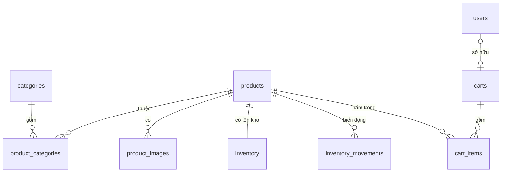

# Module Catalog

> Trạng thái: **nháp**, chờ review. Mọi con số (24 sản phẩm mỗi trang, ngưỡng "còn ít" là 5, 500 ms) là ví dụ của case study.

- **Vai trò:** Danh sách và chi tiết sản phẩm, tìm kiếm, giỏ hàng, tồn kho, quản trị sản phẩm.
- **Domain (ví dụ shop quà tặng):** Supporting. Riêng gợi ý quà là core, sẽ tách thành tính năng riêng.
- **Phụ thuộc:** Không phụ thuộc module nào. Order dùng sản phẩm và tồn kho. Auth gọi Catalog để gộp giỏ khi khách đăng nhập.

## 1. Yêu cầu nghiệp vụ và acceptance criteria

### Ai dùng

| Ai | Muốn | Để |
|---|---|---|
| Khách | Xem, tìm, lọc sản phẩm theo dịp và khoảng giá | Chọn quà nhanh |
| Khách | Thêm vào giỏ, sửa số lượng | Chuẩn bị đặt hàng |
| Khách vãng lai vừa đăng nhập | Giỏ cũ không bị mất | Không phải chọn lại |
| Admin | Thêm, sửa sản phẩm, giá, ảnh; nhập kho; kiểm kê | Quản lý hàng bán |

### Acceptance criteria

1. **Khi** mở danh sách, **thì** thấy 24 sản phẩm mỗi trang, mặc định mới nhất trước. 95% lượt tải dưới 500 ms.
2. **Khi** tìm "hộp gỗ" hoặc "hop go", **thì** đều ra sản phẩm có tên chứa cụm đó.
3. **Khi** lọc theo dịp và khoảng giá, **thì** kết quả đúng, và bộ lọc nằm trong đường dẫn để gửi được cho người khác.
4. **Khi** sản phẩm hết hàng, **thì** vẫn hiện nhưng nút "Thêm vào giỏ" bị khóa và ghi "Tạm hết".
5. **Khi** thêm vào giỏ nhiều hơn số đang có, **thì** báo số tối đa có thể thêm. Giỏ không giữ hàng ([ADR 0004](../../decisions/0004-giu-hang-khi-tao-don.md)).
6. **Khi** khách vãng lai đăng nhập, **thì** giỏ của phiên được gộp vào giỏ tài khoản: cộng số lượng, tối đa 10 mỗi món, bỏ món đã ngừng bán.
7. **Khi** admin đổi giá, **thì** đơn đã đặt không đổi, còn giỏ hiển thị giá mới kèm ghi chú "giá đã thay đổi".
8. **Khi** admin ngừng bán một sản phẩm, **thì** nó biến khỏi danh sách và tìm kiếm; trong giỏ ghi "không còn bán".
9. **Khi** admin chỉnh tồn kho xuống dưới số đang được giữ cho đơn, **thì** bị từ chối.

Hiển thị tồn kho cho khách: "Còn hàng", "Còn ít" (từ 5 trở xuống) hoặc "Tạm hết". Không hiển thị số chính xác: số này là ước tính vì có cache, và kiểm tra thật xảy ra lúc tạo đơn.

### Giao diện

| Trạng thái | Hiển thị |
|---|---|
| Đang tải | Khung xương của thẻ sản phẩm, giữ nguyên bố cục |
| Trống | Không có kết quả: gợi ý bỏ bớt bộ lọc, đường dẫn xem tất cả |
| Lỗi | Thông báo và nút thử lại, không mất bộ lọc đang chọn |
| Giỏ trống | Đường dẫn về danh sách sản phẩm |

**Accessibility:** ảnh có `alt` mô tả sản phẩm; bộ lọc dùng được bằng bàn phím; số kết quả tìm được đọc qua `aria-live`; "Tạm hết" không chỉ thể hiện bằng màu.

### Ngoài phạm vi

Biến thể (màu, kích cỡ), gợi ý quà, đánh giá sản phẩm, nhiều kho, tìm kiếm theo nghĩa.

## 2. Phân loại domain

| Phần | Loại | Lý do | Cách làm |
|---|---|---|---|
| Trang danh sách, chi tiết, danh mục | Supporting | Cần có, ai cũng có | Tự làm, vừa đủ |
| Giỏ hàng | Supporting | Hành vi quen thuộc, ít khác biệt | Tự làm |
| Tồn kho | Supporting | Đơn giản vì chỉ có một kho | Tự làm, chú trọng tính đúng |
| Tìm kiếm | Generic | Bài toán chung | Dùng full-text của database trước, dịch vụ tìm kiếm khi cần |
| Gợi ý quà | **Core** | Lý do khách chọn shop | Ngoài phạm vi bản đầu, thiết kế riêng sau |

## 3. Mô hình dữ liệu

### products

| Cột | Kiểu | Ràng buộc, ghi chú |
|---|---|---|
| `id` | text | PK, `prd_` + chuỗi ngẫu nhiên |
| `slug` | text | UQ, dùng trong đường dẫn |
| `name` | text | |
| `name_search` | text | Tên đã bỏ dấu và viết thường, có chỉ mục tìm kiếm |
| `description` | text | Văn bản thuần hoặc Markdown đã lọc, không nhận HTML |
| `price` | bigint | > 0, theo đồng |
| `status` | text | `draft`, `active`, `archived` |
| `created_at`, `updated_at` | timestamptz | |

Sản phẩm không bao giờ bị xóa, chỉ chuyển `archived`, vì `order_items` vẫn trỏ tới nó.

### categories, product_categories, product_images

- `categories`: `id`, `slug` UQ, `name`, `kind` (`occasion` cho dịp như sinh nhật, Tết; `type` cho loại quà).
- `product_categories`: cặp `(product_id, category_id)` UQ.
- `product_images`: `product_id`, `url`, `alt` (bắt buộc), `position`.

### inventory và inventory_movements

| Bảng | Cột chính | Ràng buộc |
|---|---|---|
| `inventory` | `product_id` PK, `on_hand`, `reserved` | `on_hand >= 0`, `reserved >= 0`, `reserved <= on_hand` |
| `inventory_movements` | `product_id`, `delta_on_hand`, `delta_reserved`, `reason`, `ref_id`, `created_by`, `created_at` | `reason` thuộc: `import`, `reserve`, `release`, `sell`, `adjust` |

Mọi thay đổi tồn kho ghi thêm một dòng `inventory_movements` trong cùng transaction. Nhờ vậy luôn truy được vì sao tồn kho là con số hiện tại.

### carts và cart_items

| Bảng | Cột chính | Ràng buộc, ghi chú |
|---|---|---|
| `carts` | `id`, `user_id` (UQ, rỗng được), `session_id` (UQ, rỗng được), `updated_at` | Có đúng một trong hai: `user_id` hoặc `session_id` |
| `cart_items` | `cart_id`, `product_id`, `quantity`, `price_when_added` | UQ theo cặp; `quantity` 1-10; `price_when_added` để phát hiện giá đã đổi |

Giỏ không hoạt động 30 ngày thì bị xóa.

**Chỉ mục:** `products(status, created_at DESC)`; chỉ mục tìm kiếm trên `name_search`; `product_categories(category_id)`.

## 4. API contract

### Public

| Endpoint | Ghi chú |
|---|---|
| `GET /api/v1/products` | Tham số: `q`, `category`, `minPrice`, `maxPrice`, `sort` (`newest`, `price_asc`, `price_desc`), `cursor`, `limit` (tối đa 48). Chỉ sản phẩm `active` |
| `GET /api/v1/products/{slug}` | Sản phẩm `draft` hoặc `archived` trả 404 |
| `GET /api/v1/categories` | |
| `GET /api/v1/cart` | Theo tài khoản nếu đăng nhập, ngược lại theo cookie phiên |
| `PUT /api/v1/cart/items/{productId}` | Body `{ "quantity": 3 }`. Đặt số lượng tuyệt đối nên gửi lại nhiều lần vẫn cho cùng kết quả. `0` là xóa |
| `DELETE /api/v1/cart/items/{productId}` | |

Mỗi sản phẩm trả `stockLevel`: `in_stock`, `low` hoặc `out_of_stock`, không trả số tồn. Danh sách sản phẩm được cache công khai 60 giây.

Gộp giỏ không có endpoint riêng: Auth gọi `CartService.merge(sessionCart, userId)` ngay sau khi đăng nhập thành công.

### Admin

| Endpoint | Ghi chú |
|---|---|
| `POST /api/v1/admin/products`, `PATCH /api/v1/admin/products/{id}` | Ghi audit log cho thay đổi giá và trạng thái |
| `POST /api/v1/admin/products/{id}/images` | Chỉ JPG, PNG, WebP, tối đa 5 MB |
| `POST /api/v1/admin/inventory/{productId}/adjustments` | Body `{ "deltaOnHand": 20, "reason": "import", "note": "..." }` |

### Mã lỗi riêng của module

| HTTP | `code` | Khi nào |
|---|---|---|
| 404 | `NOT_FOUND` | Sản phẩm không tồn tại hoặc chưa bán |
| 409 | `SLUG_TAKEN` | Slug đã được dùng |
| 409 | `INVENTORY_BELOW_RESERVED` | Chỉnh tồn xuống dưới số đang giữ |
| 422 | `PRODUCT_UNAVAILABLE` | Thêm sản phẩm ngừng bán vào giỏ |
| 422 | `QUANTITY_EXCEEDS_STOCK` | Thêm quá số có, `details` ghi số tối đa |
| 415 | `UNSUPPORTED_MEDIA_TYPE` | Ảnh sai định dạng |

## 5. Trạng thái

### Sản phẩm

| Từ | Đến | Ai | Ghi chú |
|---|---|---|---|
| `draft` | `active` | Admin | Bắt buộc có giá, ít nhất một ảnh có `alt` |
| `active` | `archived` | Admin | Ẩn khỏi danh sách; đơn cũ không ảnh hưởng |
| `archived` | `active` | Admin | Bán lại |

### Tồn kho

Tồn kho không có vòng đời trạng thái, nhưng có các thao tác với quy tắc rõ ràng:

| Thao tác | `on_hand` | `reserved` | Ai kích hoạt |
|---|---|---|---|
| Nhập kho | + số lượng | | Admin |
| Giữ hàng | | + số lượng | Order, khi tạo đơn |
| Nhả hàng | | − số lượng | Order, khi đơn hủy hoặc hết hạn |
| Bán | − số lượng | − số lượng | Order, khi đơn đã thanh toán |
| Điều chỉnh kiểm kê | ± số lượng | | Admin, không được xuống dưới `reserved` |

Mọi thao tác dùng [cập nhật có điều kiện](../../02-how-to/chong-ban-vuot-ton-kho.md) và ghi `inventory_movements`.

## 6. Threat model

Tài sản cần bảo vệ: giá và trạng thái sản phẩm, tính đúng của tồn kho, quyền admin, hạ tầng lưu ảnh.

| Mối đe dọa | Ví dụ cụ thể | Cách chặn | Kiểm bằng |
|---|---|---|---|
| Dùng API admin trái phép | Khách gọi thẳng `PATCH /admin/products` | Kiểm vai trò ở server cho mọi endpoint admin | Test phân quyền |
| Tải file độc | File thực thi đổi đuôi thành `.jpg` | Kiểm loại file thật theo nội dung, xử lý lại ảnh, tên file ngẫu nhiên, lưu ngoài server ứng dụng | Test với file giả |
| Chèn mã vào mô tả | Mô tả chứa `<script>` | Không nhận HTML, lọc Markdown khi hiển thị | Test hiển thị |
| Lộ sản phẩm chưa bán | Đoán slug của sản phẩm `draft` | Trả 404 cho mọi sản phẩm không `active` | Test truy cập |
| Quá tải tìm kiếm | Bot gửi hàng nghìn truy vấn | Giới hạn tần suất, cache, giới hạn độ dài `q` | Test tải |
| Chiếm giỏ người khác | Đoán `session_id` | Mã ngẫu nhiên đủ dài, cookie `HttpOnly`, `Secure`, `SameSite=Lax` | Review cấu hình cookie |
| Chèn SQL qua tìm kiếm | `q` chứa câu lệnh | Truy vấn tham số hóa | Test với chuỗi đặc biệt |

## 7. Test strategy

| Tầng | Test gì | Ai viết |
|---|---|---|
| Unit | Bỏ dấu khi tìm; ngưỡng `stockLevel`; gộp giỏ (cộng số lượng, trần 10, bỏ món ngừng bán) | AI viết, người nêu trường hợp |
| Integration | Lọc, sắp xếp, phân trang ổn định khi có sản phẩm mới; `PUT` với 0 là xóa; sản phẩm `draft` trả 404; chỉnh tồn dưới `reserved` trả 409; mọi thay đổi tồn có dòng `inventory_movements` | AI nháp, người duyệt |
| Đồng thời | Admin chỉnh tồn đúng lúc Order giữ hàng: bất biến `reserved <= on_hand` luôn đúng | Người viết |
| Contract | Response danh sách, chi tiết, giỏ khớp với frontend | AI viết |
| E2E | Tìm, lọc, thêm vào giỏ, đăng nhập, giỏ được gộp | Cả hai |
| Hiệu năng | Danh sách và tìm kiếm với 10.000 sản phẩm: p95 dưới 500 ms | Cả hai |

## 8. Vận hành

### Log

| Sự kiện | Trường chính |
|---|---|
| `product_updated` | product_id, admin_id, trường thay đổi, giá cũ và mới |
| `inventory_adjusted` | product_id, delta, lý do, admin_id |
| `cart_merged` | user_id, số món gộp, số món bị bỏ |

### Metric và cảnh báo

| Metric | Cảnh báo khi |
|---|---|
| p95 của danh sách và tìm kiếm | Trên 500 ms trong 15 phút |
| Tỷ lệ tìm kiếm không có kết quả | Theo dõi hằng tuần: cho biết khách tìm gì mà shop chưa có |
| Lượt xem sản phẩm "Tạm hết" | Theo dõi để nhập hàng |
| Vi phạm bất biến tồn kho | Bất kỳ trường hợp nào |

### Job nền

| Job | Lịch | Việc làm |
|---|---|---|
| Kiểm tra tồn kho | Hằng đêm | `reserved` bằng tổng số lượng của các đơn "chờ thanh toán"; `on_hand` khớp với tổng `inventory_movements`. Lệch thì cảnh báo |
| Dọn giỏ | Hằng ngày | Xóa giỏ không hoạt động quá 30 ngày |

## 9. Quyết định (ADR)

| ADR | Nội dung | Trạng thái |
|---|---|---|
| [0004](../../decisions/0004-giu-hang-khi-tao-don.md) | Giữ hàng khi tạo đơn, không giữ khi thêm vào giỏ | Đề xuất |

**Còn để ngỏ:**

- Khi nào chuyển từ full-text của database sang dịch vụ tìm kiếm riêng: ví dụ khi có trên 50.000 sản phẩm hoặc cần tìm theo nghĩa.
- Ảnh lưu ở đâu và phục vụ qua CDN nào.
- Ngưỡng "còn ít" chung cho mọi sản phẩm hay theo từng sản phẩm.

## 10. Ranh giới giao việc cho AI

| Phần | Mức | Ghi chú |
|---|---|---|
| UI danh sách, bộ lọc, chi tiết, giỏ | AI làm | Kiểm `alt` và thao tác bàn phím |
| API danh sách, tìm kiếm, giỏ | AI làm | Đọc kỹ phần tham số hóa truy vấn |
| CRUD sản phẩm cho admin | AI làm | Người kiểm phần phân quyền |
| Tải ảnh lên | AI nháp, người duyệt | Kiểm loại file theo nội dung |
| Thao tác tồn kho, job kiểm tra | AI nháp, người duyệt | Tự chạy test đồng thời |
| Gộp giỏ | AI nháp, người duyệt | |
| Phân quyền admin | Người quyết | Thuộc Auth |

### Checklist review riêng của Catalog

- [ ] Sản phẩm không `active` không lộ ra ở API public.
- [ ] Mọi thay đổi tồn kho có dòng `inventory_movements` trong cùng transaction.
- [ ] API public không trả số tồn chính xác.
- [ ] Ảnh được kiểm loại file theo nội dung, không tin đuôi file.
- [ ] Mô tả sản phẩm không được hiển thị như HTML thô.
