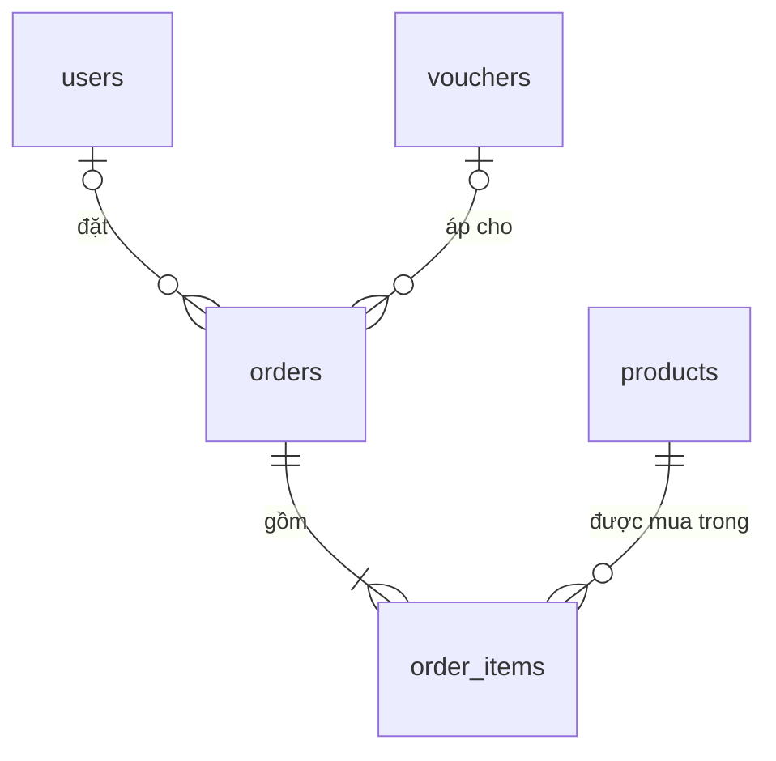

# Module Order

> Trạng thái: **nháp**, chờ review. Mọi con số (15 phút, 500.000đ, 800 ms) là ví dụ của case study.

- **Vai trò:** Tạo đơn, tính tiền, giữ hàng, xem và hủy đơn.
- **Domain (ví dụ shop quà tặng):** Supporting. Riêng quy tắc khuyến mãi là core.
- **Phụ thuộc:** Cần Catalog (sản phẩm, tồn kho). Không cần Auth nhờ [guest checkout](../../decisions/0002-guest-checkout.md). Payment và Notify phụ thuộc vào Order.

## 1. Yêu cầu nghiệp vụ và acceptance criteria

### Ai dùng

| Ai | Muốn | Để |
|---|---|---|
| Khách vãng lai | Đặt hàng chỉ với email và số điện thoại | Mua quà nhanh, không phải đăng ký |
| Khách đã đăng nhập | Đặt hàng, xem lại các đơn cũ | Theo dõi đơn ở một chỗ |
| Khách | Hủy đơn chưa thanh toán | Đổi ý trước khi trả tiền |
| Nhân viên hỗ trợ | Xem, lọc đơn theo trạng thái, chuyển đơn sang "đang giao" | Xử lý giao hàng |

### Acceptance criteria

1. **Khi** giỏ có hàng còn tồn và thông tin giao hàng hợp lệ, **thì** tạo đơn "chờ thanh toán", trả tổng tiền và đường dẫn thanh toán. 95% lượt tạo đơn phản hồi dưới 800 ms.
2. **Khi** khách bấm đặt hàng hai lần với cùng Idempotency-Key, **thì** chỉ có một đơn.
3. **Khi** một món không đủ hàng, **thì** không tạo đơn, báo đúng món nào thiếu và còn bao nhiêu.
4. **Khi** shop đổi giá sau khi khách đã đặt, **thì** đơn giữ nguyên giá lúc đặt.
5. **Khi** quá 15 phút đơn chưa được thanh toán, **thì** đơn chuyển "đã hủy" và hàng được nhả (sau khi đã hỏi lại cổng, xem mục 8).
6. **Khi** khách vãng lai đặt xong, **thì** nhận email có đường dẫn xem đơn chứa mã bí mật.
7. **Khi** người A mở đơn của người B, **thì** nhận 404 như thể đơn không tồn tại.
8. **Khi** khách hủy đơn "chờ thanh toán", **thì** đơn hủy và hàng được nhả. Đơn đã thanh toán không hủy được qua chức năng này.

### Quy tắc tính tiền (core, PO duyệt)

| Quy tắc | Giá trị ví dụ |
|---|---|
| Tạm tính | Tổng (đơn giá lúc đặt × số lượng) |
| Voucher | Tối đa 1 mã mỗi đơn. Giảm theo % hoặc số tiền cố định, tối đa 50% tạm tính. Có hạn dùng và số lượt |
| Phí ship | 30.000đ, miễn phí khi tạm tính trừ giảm giá từ 500.000đ |
| Tổng | Tạm tính − giảm giá + phí ship, không bao giờ âm |
| Giới hạn | 1-10 cái mỗi món, tối đa 20 món khác nhau mỗi đơn |

Giá luôn được tính lại ở server từ database. Giá do trình duyệt gửi lên bị bỏ qua.

### Giao diện

| Trạng thái | Hiển thị |
|---|---|
| Đang tải | Nút "Đặt hàng" bị khóa, chữ đổi thành "Đang đặt hàng" |
| Trống | Giỏ trống: thông báo kèm đường dẫn về trang sản phẩm |
| Lỗi | Hết hàng: đánh dấu đúng món và số còn lại. Lỗi mạng: nút "Thử lại" gửi lại cùng Idempotency-Key |
| Thành công | Chuyển sang trang của cổng thanh toán |

**Accessibility:** mọi ô nhập có nhãn; lỗi gắn với ô bằng `aria-describedby`; thông báo lỗi chung và tổng tiền thay đổi được đọc qua vùng `aria-live`; toàn bộ luồng dùng được bằng bàn phím.

### Ngoài phạm vi

Sửa đơn sau khi đặt, tách đơn, giao nhiều địa chỉ, thanh toán khi nhận hàng (COD), đổi trả hàng. Thêm COD sau này cần một ADR, vì nó đổi vòng đời đơn.

## 2. Phân loại domain

| Phần | Loại | Lý do | Cách làm |
|---|---|---|---|
| Quy tắc voucher, khuyến mãi | **Core** | Shop quà tặng cạnh tranh bằng ưu đãi theo dịp | Spec chi tiết, người quyết, test kỹ |
| Tạo đơn, giữ hàng, vòng đời đơn | Supporting | Cần có, nhưng khách không chọn shop vì nó | Tự làm theo mẫu phổ biến, vừa đủ |
| Tính phí ship | Supporting | Quy tắc đơn giản ở bản đầu | Tự làm, sau này có thể gọi dịch vụ vận chuyển |

**Tự làm hay dùng sẵn:** tự làm, vì đơn hàng gắn chặt với tồn kho và voucher riêng của shop. Nếu shop chạy trên một nền tảng thương mại điện tử có sẵn, Order sẽ thành generic và trang này chỉ còn phần voucher.

## 3. Mô hình dữ liệu



### orders

| Cột | Kiểu | Ràng buộc, ghi chú |
|---|---|---|
| `id` | text | PK, dạng `ord_` + chuỗi ngẫu nhiên, không đoán được |
| `user_id` | FK users | Rỗng nếu là khách vãng lai |
| `guest_email` | text | Bắt buộc khi `user_id` rỗng: `CHECK (user_id IS NOT NULL OR guest_email IS NOT NULL)` |
| `status` | text | `CHECK` thuộc: `pending_payment`, `paid`, `shipping`, `completed`, `cancelled`, `refunded` |
| `subtotal`, `discount`, `shipping_fee`, `total` | bigint | Đều ≥ 0, và `total = subtotal - discount + shipping_fee` |
| `currency` | text | Mặc định `VND` |
| `voucher_code` | FK vouchers | Rỗng được |
| `shipping_address` | jsonb | Bản chụp tại lúc đặt |
| `idempotency_key` | text | UQ |
| `request_hash` | text | Băm nội dung request, để phát hiện cùng key khác nội dung |
| `guest_token_hash` | text | Chỉ lưu bản băm của mã bí mật |
| `expires_at` | timestamptz | Hạn thanh toán |
| `created_at`, `updated_at` | timestamptz | |

Chỉ mục: `(user_id, created_at DESC)` cho "đơn của tôi"; `(status, expires_at)` cho job hủy đơn hết hạn.

### order_items

| Cột | Kiểu | Ràng buộc, ghi chú |
|---|---|---|
| `order_id`, `product_id` | FK | UQ theo cặp |
| `name_snapshot` | text | Tên lúc mua |
| `unit_price_snapshot` | bigint | > 0, giá lúc mua |
| `quantity` | int | 1-10 |

### vouchers

| Cột | Kiểu | Ràng buộc, ghi chú |
|---|---|---|
| `code` | text | PK, tối thiểu 8 ký tự |
| `kind` | text | `percent` hoặc `fixed` |
| `value` | bigint | % hoặc số tiền |
| `starts_at`, `ends_at` | timestamptz | |
| `usage_limit`, `used_count` | int | `used_count <= usage_limit` |

Lượt dùng voucher được giữ khi tạo đơn bằng cập nhật có điều kiện (`WHERE used_count < usage_limit`), và trả lại khi đơn bị hủy, giống [cách giữ tồn kho](../../02-how-to/chong-ban-vuot-ton-kho.md).

**Migration:** cả ba bảng là bảng mới nên tạo trực tiếp; quay lui bằng cách xóa bảng khi chưa có dữ liệu thật. Có dữ liệu thật rồi thì mọi thay đổi theo [mở rộng rồi thu hẹp](../../02-how-to/migration-an-toan.md).

## 4. API contract

Contract chi tiết của tạo đơn và mô hình lỗi: [API đặt hàng](../../03-reference/api-dat-hang.md).

| Endpoint | Ai gọi | Ghi chú |
|---|---|---|
| `POST /api/v1/orders/quote` | Mọi người | Tính thử tạm tính, giảm giá, phí ship. Không tạo đơn, không giữ hàng |
| `POST /api/v1/orders` | Khách vãng lai hoặc đã đăng nhập | Bắt buộc `Idempotency-Key`. Trả 201 |
| `GET /api/v1/orders` | Đã đăng nhập | Chỉ đơn của mình, phân trang bằng cursor |
| `GET /api/v1/orders/{id}` | Chủ đơn, hoặc khách vãng lai có `?token=` | Không phải chủ thì 404 |
| `POST /api/v1/orders/{id}/cancel` | Chủ đơn | Chỉ khi `pending_payment`, ngược lại 409 |
| `GET /api/v1/admin/orders` | Admin | Lọc theo trạng thái, ngày |
| `POST /api/v1/admin/orders/{id}/ship` | Admin | `paid` → `shipping` |

### Mã lỗi riêng của module

| HTTP | `code` | Khi nào |
|---|---|---|
| 400 | `VALIDATION_FAILED` | Sai định dạng, số lượng ngoài 1-10, quá 20 món |
| 404 | `NOT_FOUND` | Không có đơn, hoặc không phải chủ đơn |
| 409 | `IDEMPOTENCY_CONFLICT` | Cùng key nhưng khác nội dung |
| 409 | `ORDER_NOT_CANCELLABLE` | Hủy đơn không ở `pending_payment` |
| 422 | `OUT_OF_STOCK` | Không đủ hàng, `details` liệt kê từng món |
| 422 | `PRODUCT_UNAVAILABLE` | Sản phẩm ngừng bán |
| 422 | `VOUCHER_INVALID` | Mã sai, hết hạn hoặc hết lượt |
| 429 | `RATE_LIMITED` | Vượt giới hạn tần suất |

### Idempotency

- Key giữ trong 24 giờ.
- Cùng key, cùng nội dung: trả lại đúng phản hồi lần đầu.
- Cùng key, khác nội dung: 409 `IDEMPOTENCY_CONFLICT`.

### Giới hạn tần suất

10 lần tạo đơn mỗi phút mỗi IP; tối đa 3 đơn "chờ thanh toán" cùng lúc cho mỗi email.

## 5. Trạng thái

Sơ đồ đầy đủ ở [Trạng thái đơn và thanh toán](../../03-reference/trang-thai.md). Bảng dưới là điều kiện cho từng bước chuyển do Order quản lý.

| Bước chuyển | Ai kích hoạt | Điều kiện | Tác động |
|---|---|---|---|
| (mới) → `pending_payment` | Khách | Đủ hàng, voucher hợp lệ | Giữ hàng, giữ lượt voucher, tạo payment "đang chờ" |
| `pending_payment` → `paid` | Sự kiện từ Payment | Payment thành công, số tiền khớp | Trừ tồn kho, ghi outbox gửi email |
| `pending_payment` → `cancelled` | Khách, hoặc job hết hạn | Chưa có payment thành công | Nhả hàng, trả lượt voucher |
| `paid` → `shipping` | Admin | | |
| `shipping` → `completed` | Đơn vị vận chuyển hoặc admin | | |
| `paid` → `refunded` | Sự kiện từ Payment | Hoàn tiền thành công | Trả hàng về kho nếu chưa giao |

Mọi bước chuyển dùng cập nhật có điều kiện, để hai bên cùng chuyển một lúc thì chỉ một bên thắng:

```sql
UPDATE orders SET status = 'cancelled', updated_at = now()
WHERE id = :id AND status = 'pending_payment';
-- 0 dòng: trạng thái đã đổi, trả 409 hoặc bỏ qua
```

**Tranh chấp đáng chú ý:** khách bấm hủy đúng lúc cổng báo đã trả tiền. Nếu lệnh hủy thắng, Payment nhận tiền cho một đơn đã hủy và tự tạo yêu cầu hoàn tiền (xem [Module Payment](payment.md), mục 5).

## 6. Threat model

Tài sản cần bảo vệ: thông tin cá nhân (email, số điện thoại, địa chỉ), tính đúng của giá và tổng tiền, tồn kho.

| Mối đe dọa | Ví dụ cụ thể | Cách chặn | Kiểm bằng |
|---|---|---|---|
| Sửa giá | Gửi `unitPrice: 1000` lên API | Bỏ qua giá từ client, tính lại từ DB | Test gửi giá giả |
| Xem đơn người khác | Đổi mã đơn trên đường dẫn | Kiểm chủ sở hữu, trả 404, mã đơn ngẫu nhiên | Test truy cập chéo |
| Giữ hết hàng | Bot tạo hàng loạt đơn không trả tiền | Giới hạn tần suất, tối đa 3 đơn chờ mỗi email, giữ hàng có hạn | Test tải |
| Dò voucher | Thử hàng nghìn mã qua `/quote` | Giới hạn tần suất, mã ≥ 8 ký tự, cảnh báo khi tỷ lệ mã sai cao | Test giới hạn |
| Dùng voucher quá lượt | Nhiều đơn cùng lúc dùng mã còn 1 lượt | Giữ lượt bằng cập nhật có điều kiện | Test đồng thời |
| Lộ đường dẫn của khách vãng lai | Đường dẫn bị chuyển tiếp | Chỉ lưu bản băm, hết hạn sau 30 ngày, không ghi vào log | Review log |
| Lộ thông tin cá nhân | Email, địa chỉ trong log | Che thông tin khi ghi log | Review log mẫu |
| Số lượng bất thường | Số lượng âm hoặc rất lớn | Kiểm 1-10 ở API và `CHECK` ở DB | Unit test |

## 7. Test strategy

| Tầng | Test gì | Ai viết |
|---|---|---|
| Unit | Tính tiền: voucher %, cố định, trần 50%, ngưỡng miễn ship, tổng không âm. Bảng chuyển trạng thái hợp lệ và không hợp lệ | AI viết, người nêu trường hợp |
| Integration | `POST /orders`: 201, 400, 409, 422; gửi lại cùng key; truy cập chéo trả 404; hủy đơn đã thanh toán trả 409 | AI nháp, người duyệt |
| Đồng thời | 20 request cùng mua món cuối: đúng 1 thành công. Voucher còn 1 lượt: đúng 1 đơn dùng được. Hủy và thanh toán cùng lúc | Người viết |
| Contract | Response khớp contract mà frontend dùng | AI viết |
| E2E | Chọn hàng, đặt, thanh toán qua cổng giả lập, thấy đơn "đã thanh toán". Giỏ trống. Hết hàng giữa chừng | Cả hai |

**Trường hợp biên bắt buộc:** đơn đúng ngưỡng 500.000đ sau giảm giá; voucher hết hạn đúng lúc đặt; sản phẩm ngừng bán khi đang ở trong giỏ; 20 món khác nhau; tạo đơn khi mạng chập chờn và gửi lại.

**Dữ liệu test:** tạo bằng factory, không dùng dữ liệu thật.

## 8. Vận hành

### Log (không chứa thông tin cá nhân)

| Sự kiện | Trường chính |
|---|---|
| `order_created` | order_id, số món, total, khách vãng lai hay đăng nhập, request_id |
| `order_cancelled` | order_id, lý do (khách, hết hạn) |
| `order_out_of_stock` | product_id, số yêu cầu, số còn |
| `order_idempotent_replay` | order_id |
| `order_invalid_transition` | order_id, từ, sang (mức cảnh báo) |

### Metric và cảnh báo

| Metric | Cảnh báo khi |
|---|---|
| Tỷ lệ lỗi 5xx của tạo đơn | Trên 1% trong 10 phút |
| Thời gian tạo đơn p95 | Trên 800 ms trong 15 phút |
| Số đơn "chờ thanh toán" | Tăng gấp 3 so với cùng giờ tuần trước |
| Độ trễ của job hết hạn | Job không chạy quá 10 phút |
| Tỷ lệ hết hàng khi đặt | Theo dõi, chưa cảnh báo |

### Job hủy đơn hết hạn

Chạy mỗi phút, mỗi lần tối đa 100 đơn, dùng `FOR UPDATE SKIP LOCKED` để nhiều bản chạy song song không đụng nhau. **Trước khi hủy, hỏi Payment kiểm tra lại với cổng**: khách có thể vừa trả tiền ở giây cuối mà webhook chưa tới. Cổng báo thành công thì chuyển "đã thanh toán", còn lại mới hủy và nhả hàng. Job chạy lại nhiều lần vẫn cho cùng kết quả.

## 9. Quyết định (ADR)

| ADR | Nội dung | Trạng thái |
|---|---|---|
| [0001](../../decisions/0001-monolith-theo-layer.md) | Monolith theo layer | Đã chấp nhận |
| [0002](../../decisions/0002-guest-checkout.md) | Cho mua không cần đăng nhập | Đã chấp nhận |
| [0004](../../decisions/0004-giu-hang-khi-tao-don.md) | Giữ hàng khi tạo đơn, không giữ khi thêm vào giỏ | Đề xuất |

**Còn để ngỏ:**

- Có làm COD không, và khi nào.
- 15 phút giữ hàng có đủ cho khách chuyển khoản bằng mã QR không.
- Voucher áp trên tạm tính (đã chọn) hay cả phí ship.

## 10. Ranh giới giao việc cho AI

| Phần | Mức | Ghi chú |
|---|---|---|
| UI giỏ hàng, form, các trạng thái | AI làm | Người tự thử bằng bàn phím và các trạng thái lỗi |
| Controller và kiểm tra đầu vào theo contract | AI làm | Đọc kỹ phần kiểm tra |
| Tính tiền, voucher | Người quyết | PO viết spec, dev duyệt code, AI viết test theo danh sách trường hợp |
| Tạo đơn trong transaction, giữ hàng, giữ voucher | AI nháp, người duyệt | Tự chạy test đồng thời |
| Kiểm chủ sở hữu, mã bí mật cho khách vãng lai | Người quyết | |
| Job hủy đơn hết hạn | AI nháp, người duyệt | Kiểm bước hỏi lại Payment |
| Migration | AI nháp, người duyệt | Chạy thử trên bản sao dữ liệu |

### Checklist review riêng của Order

- [ ] Giá và tổng tiền luôn tính lại từ database.
- [ ] Mọi truy vấn đơn có điều kiện chủ sở hữu, trừ API admin.
- [ ] Mọi đổi trạng thái có `WHERE status = ...`.
- [ ] Tiền là số nguyên, không có phép chia làm tròn ngầm.
- [ ] Không ghi email, số điện thoại, địa chỉ vào log.
