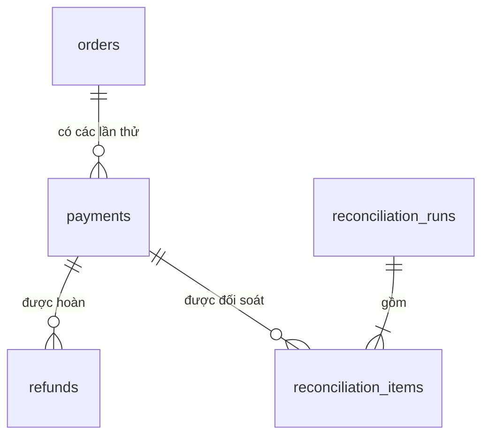

# Module Payment

> Trạng thái: **nháp**, chờ review. Tên cổng thanh toán cụ thể chưa chốt; mọi chi tiết về API của cổng phải đối chiếu với tài liệu chính thức của cổng được chọn.

- **Vai trò:** Tạo giao dịch với cổng, nhận kết quả, đối soát, hoàn tiền.
- **Domain (ví dụ shop quà tặng):** Generic: dùng cổng có sẵn. Rủi ro rất cao.
- **Phụ thuộc:** Cần Order. Order và Notify nhận sự kiện từ Payment.

Đọc trước: [Thanh toán là quy trình bất đồng bộ](../../04-explanation/thanh-toan-bat-dong-bo.md) và [ADR 0003](../../decisions/0003-webhook-xac-nhan-thanh-toan.md).

## 1. Yêu cầu nghiệp vụ và acceptance criteria

### Ai dùng

| Ai | Muốn | Để |
|---|---|---|
| Khách | Trả tiền trên trang của cổng (thẻ, QR, ví tùy cổng) | Thanh toán quen thuộc, an toàn |
| Khách | Thấy kết quả rõ ràng, thử lại khi thất bại | Không phải đoán đã trả tiền chưa |
| Kế toán | Báo cáo đối soát hằng ngày, danh sách giao dịch lệch | Sổ sách khớp với tiền về |
| Admin | Hoàn tiền toàn bộ cho một đơn, có ghi lý do | Xử lý khiếu nại |

### Acceptance criteria

1. **Khi** đơn được tạo, **thì** có đúng một payment "đang chờ" và một đường dẫn tới trang của cổng.
2. **Khi** cổng gửi webhook thành công có chữ ký hợp lệ, **thì** payment "thành công" và đơn "đã thanh toán", xử lý xong trong 5 giây kể từ lúc nhận.
3. **Khi** cùng webhook được gửi lại, **thì** không có gì thay đổi và trả 200.
4. **Khi** webhook sai chữ ký, **thì** trả 401, không đổi gì, ghi cảnh báo.
5. **Khi** khách quay về trang kết quả trước khi webhook tới, **thì** thấy "đang xử lý" và trang tự cập nhật.
6. **Khi** thanh toán thất bại và đơn còn hạn, **thì** khách thử lại được, mỗi lần thử là một payment mới.
7. **Khi** một payment "đang chờ" quá 15 phút, **thì** job hỏi lại cổng và cập nhật đúng trạng thái.
8. **Khi** số tiền cổng báo khác số tiền của payment, **thì** không đánh dấu thành công và cảnh báo ngay.
9. **Khi** tiền về cho một đơn đã hủy, **thì** hệ thống tự tạo yêu cầu hoàn tiền và cảnh báo.
10. **Khi** đối soát cuối ngày, **thì** mọi giao dịch lệch giữa hệ thống và báo cáo của cổng được liệt kê cho kế toán.

### Giao diện

| Trạng thái | Hiển thị |
|---|---|
| Đang chuyển | "Đang chuyển sang trang thanh toán", khóa nút |
| Đang xử lý | Giải thích ngắn, tự hỏi lại server mỗi 2 giây, tối đa 2 phút, sau đó mời khách kiểm tra email |
| Thành công | Mã đơn, tổng tiền, thời gian dự kiến giao |
| Thất bại | Lý do dễ hiểu (nếu cổng cung cấp), nút "Thử lại" khi đơn còn hạn |
| Hết hạn | Đơn đã hủy, đường dẫn đặt lại |

**Accessibility:** thay đổi trạng thái được đọc qua `aria-live`; trạng thái không chỉ thể hiện bằng màu.

### Ngoài phạm vi

Hoàn tiền một phần, trả góp, lưu thẻ cho lần sau, thanh toán khi nhận hàng, nhiều loại tiền tệ.

## 2. Phân loại domain

**Generic** với shop quà tặng: khách không chọn shop vì cách thanh toán. Vì vậy dùng cổng có sẵn với **trang thanh toán do cổng cung cấp**: số thẻ không bao giờ đi qua server của shop, giảm mạnh phạm vi phải tuân thủ chuẩn bảo mật thẻ (PCI DSS). Quyết định này được đề xuất trong [ADR 0005](../../decisions/0005-dung-trang-thanh-toan-cua-cong.md).

Với một ví điện tử, Payment lại là **core**. Generic ở đây không có nghĩa là dễ: đây vẫn là module rủi ro cao nhất của hệ thống.

## 3. Mô hình dữ liệu



### payments

| Cột | Kiểu | Ràng buộc, ghi chú |
|---|---|---|
| `id` | text | PK, `pay_` + chuỗi ngẫu nhiên |
| `order_id` | FK orders | |
| `attempt_no` | int | Lần thử thứ mấy của đơn |
| `status` | text | `pending`, `succeeded`, `failed`, `expired`, `refunded` |
| `amount` | bigint | > 0, bằng `orders.total` lúc tạo |
| `currency` | text | `VND` |
| `provider` | text | Tên cổng |
| `provider_txn_id` | text | UQ theo `(provider, provider_txn_id)`, rỗng khi chưa nhận từ cổng |
| `idempotency_key` | text | UQ, gửi kèm khi gọi cổng |
| `redirect_url` | text | Chỉ nhận đường dẫn thuộc tên miền của cổng |
| `failure_code` | text | Mã lỗi từ cổng |
| `paid_at`, `created_at`, `updated_at` | timestamptz | |

Ràng buộc quan trọng, dùng chỉ mục duy nhất có điều kiện:

```sql
-- Mỗi đơn có tối đa một payment đang chờ và một payment thành công
CREATE UNIQUE INDEX one_pending_per_order   ON payments(order_id) WHERE status = 'pending';
CREATE UNIQUE INDEX one_succeeded_per_order ON payments(order_id) WHERE status = 'succeeded';
```

### webhook_events

| Cột | Ghi chú |
|---|---|
| `provider`, `event_id` | UQ theo cặp: chống xử lý trùng |
| `event_type` | |
| `payload` | Lưu nguyên văn để điều tra; xóa sau 90 ngày vì có thể chứa thông tin cá nhân |
| `signature_valid` | |
| `received_at`, `processed_at`, `result` | `result`: applied, duplicate, ignored, rejected |

### refunds

| Cột | Ghi chú |
|---|---|
| `id`, `payment_id` | |
| `amount` | Bản đầu luôn bằng `payments.amount` |
| `status` | `pending`, `succeeded`, `failed` |
| `provider_refund_id` | UQ |
| `reason`, `created_by` | Bắt buộc: ai yêu cầu, vì sao (`system` nếu tự động) |

### reconciliation_runs và reconciliation_items

Mỗi lần đối soát cuối ngày là một `run` (ngày, trạng thái, số giao dịch khớp, số lệch). Mỗi giao dịch lệch là một `item`: mã giao dịch, trạng thái và số tiền phía mình, trạng thái và số tiền phía cổng, loại lệch, người xử lý, ghi chú, thời điểm xử lý.

**Không bao giờ lưu:** số thẻ, CVV, mật khẩu ví.

## 4. API contract

### Public API

| Endpoint | Ai gọi | Ghi chú |
|---|---|---|
| `POST /api/v1/orders/{id}/payments` | Chủ đơn | Tạo lần thử mới. Bắt buộc `Idempotency-Key`. 201 trả `id`, `status`, `redirectUrl`. 409 `PAYMENT_IN_PROGRESS` nếu đang có payment chờ, 409 `ORDER_NOT_PAYABLE` nếu đơn hết hạn hoặc đã trả |
| `GET /api/v1/payments/{id}` | Chủ đơn | Trạng thái cho trang kết quả |
| `POST /api/v1/webhooks/payments/{provider}` | Cổng | Xem quy tắc bên dưới |
| `POST /api/v1/admin/payments/{id}/refunds` | Admin | Bắt buộc `reason`. Trả 202 vì hoàn tiền xử lý bất đồng bộ |
| `GET /api/v1/admin/reconciliation?date=` | Admin, kế toán | Kết quả đối soát một ngày |

Payment đầu tiên của đơn được tạo ngay trong `POST /orders`, không cần gọi riêng. Trang quay về từ cổng chỉ hiển thị, **không bao giờ đổi trạng thái**.

### Quy tắc webhook

1. Kiểm chữ ký trên **nội dung thô** của request, so sánh theo thời gian hằng định. Sai: 401.
2. Ghi `webhook_events`. Trùng `event_id`: trả 200, kết quả `duplicate`.
3. Kiểm số tiền và loại tiền với payment. Lệch: không chuyển trạng thái, cảnh báo, trả 200 để cổng không gửi lại mãi.
4. Chuyển trạng thái nếu hợp lệ, cập nhật đơn, ghi outbox, tất cả trong một transaction.
5. Phản hồi trong 2 giây. Lỗi tạm thời của mình (database không phản hồi) thì trả 5xx để cổng gửi lại.

### Port cho adapter cổng thanh toán

Lõi Payment chỉ biết giao diện này; mỗi cổng là một adapter (xem [Chiều phụ thuộc](../../04-explanation/chieu-phu-thuoc.md)):

```text
createPayment(payment)               -> { providerTxnId?, redirectUrl }
verifyWebhook(headers, rawBody)      -> event | lỗi chữ ký
queryPayment(payment)                -> pending | succeeded | failed | expired, amount
refund(payment, amount, key)         -> { providerRefundId, status }
fetchSettlementReport(date)          -> danh sách giao dịch của cổng
```

## 5. Trạng thái

Sơ đồ: [Trạng thái đơn và thanh toán](../../03-reference/trang-thai.md). Mọi bước chuyển dùng `UPDATE ... WHERE status = 'pending'`, nên webhook và job đối soát chạy cùng lúc thì chỉ một bên thắng.

### Các tình huống tranh chấp

| Tình huống | Cách xử lý |
|---|---|
| Webhook "thành công" tới khi đơn đã bị hủy | Payment vẫn chuyển "thành công" (tiền đã về thật), đơn giữ "đã hủy", tự tạo hoàn tiền với `created_by = system`, cảnh báo |
| Webhook "thất bại" tới sau "thành công" | Bỏ qua, ghi cảnh báo |
| Hai webhook khác `event_id` cho cùng giao dịch thành công | Lần thứ hai không đổi gì vì trạng thái đã là "thành công" |
| Webhook và job đối soát cùng xử lý | Cập nhật có điều kiện, bên tới sau thấy 0 dòng và bỏ qua |
| Gọi cổng bị hết thời gian chờ lúc tạo | Payment giữ "đang chờ" chưa có `provider_txn_id`; job hỏi cổng bằng idempotency key; cổng không có giao dịch thì chuyển "hết hạn" |
| Khách trả tiền ở giây cuối trước khi đơn hết hạn | Job hết hạn của Order hỏi Payment trước khi hủy (xem [Module Order](order.md), mục 8) |

**Thứ tự đảm bảo:** chỉ gọi cổng **sau khi** transaction tạo đơn và payment đã commit. Nhờ vậy webhook không bao giờ tới trước khi payment tồn tại.

## 6. Threat model

Tài sản cần bảo vệ: tiền, tính đúng của trạng thái thanh toán, secret của cổng, thông tin cá nhân trong payload.

| Mối đe dọa | Ví dụ cụ thể | Cách chặn | Kiểm bằng |
|---|---|---|---|
| Webhook giả | Gửi request giả báo "đã thanh toán" | Kiểm chữ ký; giới hạn IP nếu cổng công bố danh sách IP | Test sai chữ ký |
| Phát lại webhook cũ | Gửi lại webhook thật của đơn khác | `event_id` duy nhất; kiểm giao dịch thuộc đúng payment; kiểm thời gian nếu cổng có | Test phát lại |
| Sửa số tiền | Đổi số tiền trước khi sang cổng | Số tiền lấy từ DB; so số tiền trong webhook với payment | Test lệch số tiền |
| Giả trang quay về | Tự gõ đường dẫn `?status=success` | Trang quay về không đổi trạng thái | Test thủ công và tự động |
| Lộ secret | Khóa cổng nằm trong code hoặc log | Biến môi trường hoặc kho secret, xoay vòng định kỳ, che trong log | Quét secret trong CI |
| Hoàn tiền trái phép | Tài khoản admin bị chiếm, hoàn tiền hàng loạt | Chỉ admin, bắt buộc lý do, audit log, cảnh báo khi số lần hoàn tiền bất thường | Test phân quyền |
| Chuyển hướng độc hại | `redirect_url` trỏ sang trang lừa đảo | Chỉ nhận tên miền của cổng | Unit test |
| Lộ thông tin cá nhân | Payload webhook chứa tên, số điện thoại | Lưu có hạn 90 ngày, che khi ghi log | Review log mẫu |

## 7. Test strategy

| Tầng | Test gì | Ai viết |
|---|---|---|
| Unit | State machine: mọi bước chuyển hợp lệ và không hợp lệ. So sánh số tiền. Kiểm chữ ký bằng ví dụ mẫu trong tài liệu của cổng. Kiểm tên miền `redirect_url` | AI viết, người nêu trường hợp; người tự viết test chữ ký |
| Integration | Webhook hợp lệ → đơn đã thanh toán; gửi lại → không đổi; sai chữ ký → 401; lệch số tiền → không thanh toán và cảnh báo; tiền về cho đơn đã hủy → có hoàn tiền | Người viết, AI hỗ trợ |
| Đồng thời | Hai webhook cùng lúc; webhook và job đối soát cùng lúc | Người viết |
| Contract | Adapter với sandbox của cổng: tạo, hỏi trạng thái, hoàn tiền. Ghi lại phản hồi mẫu cho CI; chạy với sandbox thật mỗi đêm | Cả hai |
| Lỗi giả lập | Cổng hết thời gian chờ khi tạo; cổng trả 500; webhook tới chậm 10 phút | Người viết |
| Đối soát | Báo cáo giả có một giao dịch lệch số tiền, một giao dịch chỉ có ở cổng, một giao dịch chỉ có ở mình | AI nháp, người duyệt |
| E2E | Sandbox: thành công, thất bại, đóng trình duyệt giữa chừng rồi đối soát tự sửa | Cả hai |

## 8. Vận hành

### Log

Mọi log có `order_id`, `payment_id`, `request_id`. Không có số thẻ, không có payload đầy đủ.

| Sự kiện | Mức |
|---|---|
| `payment_created`, `payment_transition` | Thông tin |
| `webhook_received` (provider, event_id, chữ ký hợp lệ hay không, kết quả) | Thông tin |
| `webhook_signature_invalid` | Cảnh báo |
| `payment_amount_mismatch` | Lỗi |
| `payment_for_cancelled_order`, `refund_created`, `refund_failed` | Cảnh báo, lỗi |
| `reconciliation_mismatch` | Lỗi |

### Metric và cảnh báo

| Metric | Cảnh báo khi |
|---|---|
| Tỷ lệ thanh toán thất bại | Trên 2% trong 10 phút |
| Webhook sai chữ ký | Hơn 5 lần trong 10 phút |
| Payment "đang chờ" quá 15 phút | Hơn 20 cái |
| Lệch số tiền, lệch đối soát | Bất kỳ trường hợp nào |
| Lỗi khi gọi cổng | Trên 5% trong 5 phút |
| Job đối soát | Không chạy theo lịch |
| Thời gian từ tạo đến thành công | Theo dõi, chưa cảnh báo |

### Job nền

| Job | Lịch | Việc làm |
|---|---|---|
| Hỏi lại giao dịch đang chờ | Mỗi 5 phút | Payment chờ quá 15 phút: gọi `queryPayment`, chuyển trạng thái theo kết quả |
| Đối soát cuối ngày | 02:00 hằng ngày | Lấy báo cáo của cổng, so từng giao dịch, ghi `reconciliation_items` |
| Thử lại hoàn tiền | Mỗi 15 phút | Hoàn tiền "đang chờ" hoặc lỗi tạm thời, tối đa 5 lần rồi cảnh báo |
| Dọn payload webhook | Hằng ngày | Xóa payload quá 90 ngày, giữ lại metadata |

Runbook xử lý sự cố thanh toán thuộc [L3](../../00-lo-trinh/l3-production.md).

## 9. Quyết định (ADR)

| ADR | Nội dung | Trạng thái |
|---|---|---|
| [0003](../../decisions/0003-webhook-xac-nhan-thanh-toan.md) | Chỉ webhook và đối soát mới xác nhận thanh toán | Đã chấp nhận |
| [0005](../../decisions/0005-dung-trang-thanh-toan-cua-cong.md) | Dùng trang thanh toán của cổng, qua một adapter | Đề xuất |

**Còn để ngỏ:**

- Chọn cổng nào: so phí, phương thức hỗ trợ (thẻ nội địa, QR, ví), chất lượng sandbox, có báo cáo đối soát qua API hay không.
- Hoàn tiền tự động cho đơn đã hủy, hay cần người duyệt trên một ngưỡng số tiền.
- Thời gian lưu payload webhook: 90 ngày có đủ cho khiếu nại và kiểm toán không.

## 10. Ranh giới giao việc cho AI

| Phần | Mức | Ghi chú |
|---|---|---|
| Trang kết quả, polling trạng thái | AI làm | |
| Adapter gọi API của cổng | AI nháp, người duyệt | **AI thường bịa tên tham số và endpoint của cổng.** Đối chiếu từng trường với tài liệu chính thức |
| Kiểm chữ ký webhook | Người quyết | Test bằng ví dụ mẫu của cổng |
| State machine, xử lý webhook | Người quyết | Review từng dòng |
| Job hỏi lại, đối soát | AI nháp, người duyệt | |
| Hoàn tiền | Người quyết | |
| Dữ liệu mẫu cho test | AI làm | |

### Checklist review riêng của Payment

- [ ] Không có chỗ nào đổi trạng thái thanh toán từ trang quay về hoặc từ dữ liệu trình duyệt gửi.
- [ ] Chữ ký được kiểm trên nội dung thô, so sánh theo thời gian hằng định.
- [ ] Mọi bước chuyển có `WHERE status = 'pending'` (hoặc trạng thái nguồn tương ứng).
- [ ] Số tiền gửi đi lấy từ DB; số tiền nhận về được so trước khi chuyển trạng thái.
- [ ] Gọi cổng chỉ xảy ra sau khi transaction đã commit.
- [ ] Không log số thẻ, secret hay payload đầy đủ.
- [ ] Mọi lời gọi tới cổng có thời gian chờ và idempotency key.
