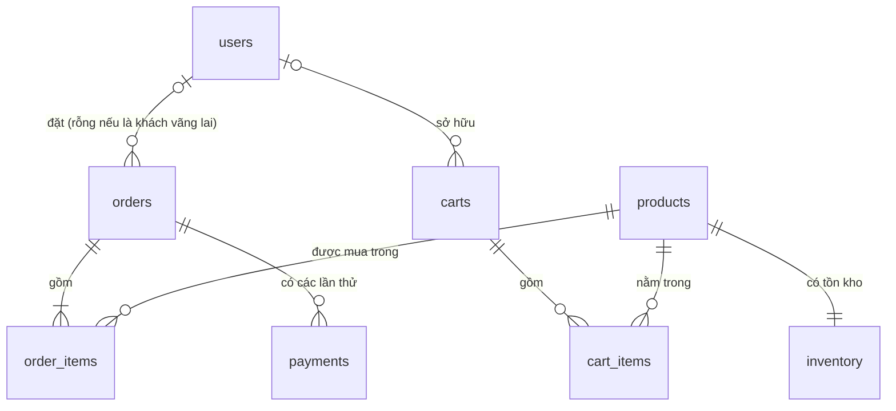

# Mô hình dữ liệu tối thiểu cho MVP bán hàng

Mười bảng đủ cho một MVP có giỏ hàng, tồn kho và thanh toán online. PK là khóa chính, FK là khóa ngoại, UQ là giá trị duy nhất.

## Nguyên tắc

- **Tiền là số nguyên** theo đơn vị đồng. Không dùng số thực, vì số thực làm tròn sai.
- **Chụp giá lúc mua.** `order_items` lưu tên và đơn giá tại thời điểm đặt, để đơn cũ không đổi khi shop sửa giá.
- **Ràng buộc nằm trong database**, không chỉ trong code: giá trị duy nhất, khóa ngoại, `quantity > 0`, `reserved <= on_hand`.
- **Mỗi lần thử thanh toán là một bản ghi** trong `payments`.

## Sơ đồ quan hệ

`webhook_events` và `outbox` không có khóa ngoại tới bảng khác: chúng là nhật ký sự kiện vào và ra.

## Các bảng

### users

| Cột | Ghi chú |
|---|---|
| `id` | PK |
| `email` | UQ |
| `password_hash` |  |
| `role` |  |

### products

| Cột | Ghi chú |
|---|---|
| `id` | PK |
| `name` |  |
| `price` | số nguyên |
| `status` |  |

### inventory

| Cột | Ghi chú |
|---|---|
| `product_id` | PK, FK |
| `on_hand` |  |
| `reserved` | ≤ on_hand |

### carts

| Cột | Ghi chú |
|---|---|
| `id` | PK |
| `user_id` | FK, rỗng được |
| `session_id` |  |

### cart_items

| Cột | Ghi chú |
|---|---|
| `cart_id` | FK |
| `product_id` | FK |
| `quantity` | > 0 |

### orders

| Cột | Ghi chú |
|---|---|
| `id` | PK |
| `user_id` | FK, rỗng được |
| `guest_email` |  |
| `status` |  |
| `subtotal, discount` |  |
| `shipping_fee, total` |  |
| `shipping_address` | bản chụp |
| `idempotency_key` | UQ |
| `expires_at` |  |

### order_items

| Cột | Ghi chú |
|---|---|
| `order_id` | FK |
| `product_id` | FK |
| `name_snapshot` | bản chụp |
| `unit_price_snapshot` | bản chụp |
| `quantity` | > 0 |

### payments

| Cột | Ghi chú |
|---|---|
| `id` | PK |
| `order_id` | FK |
| `status` |  |
| `amount` |  |
| `provider_txn_id` | UQ |
| `idempotency_key` | UQ |

### webhook_events

| Cột | Ghi chú |
|---|---|
| `event_id` | UQ |
| `provider` |  |
| `payload` |  |
| `processed_at` |  |

### outbox

| Cột | Ghi chú |
|---|---|
| `id` | PK |
| `type` |  |
| `payload` |  |
| `status` |  |
| `attempts` |  |

## Liên quan

- [Chống bán vượt tồn kho](../02-how-to/chong-ban-vuot-ton-kho.md)
- [Thay đổi database an toàn](../02-how-to/migration-an-toan.md)
- [Trạng thái đơn và thanh toán](trang-thai.md)
