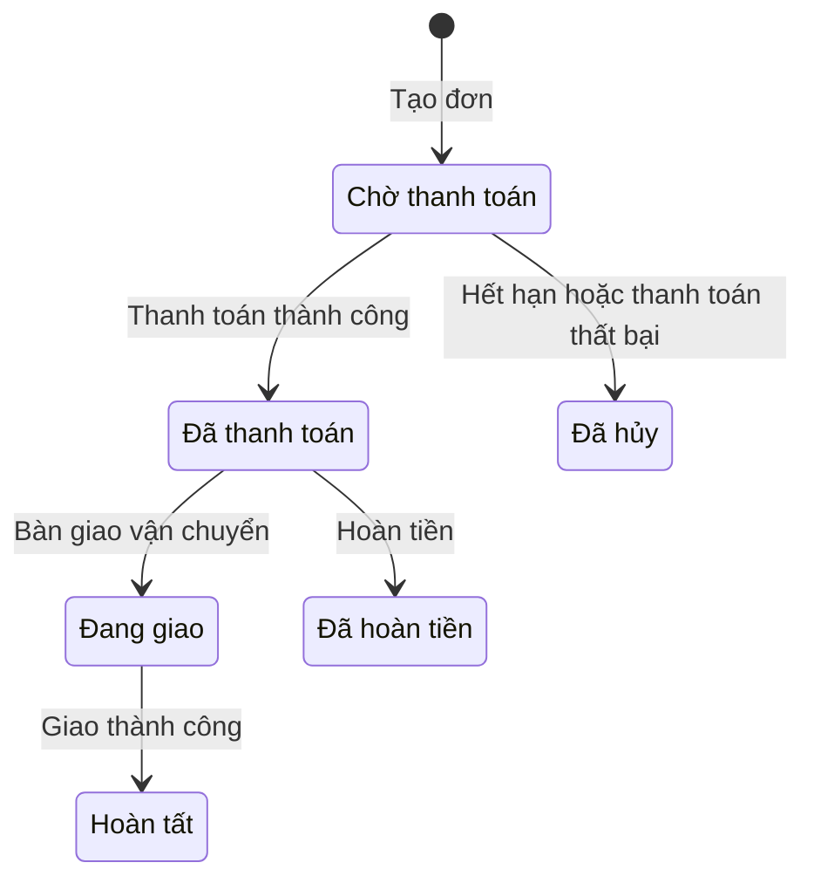
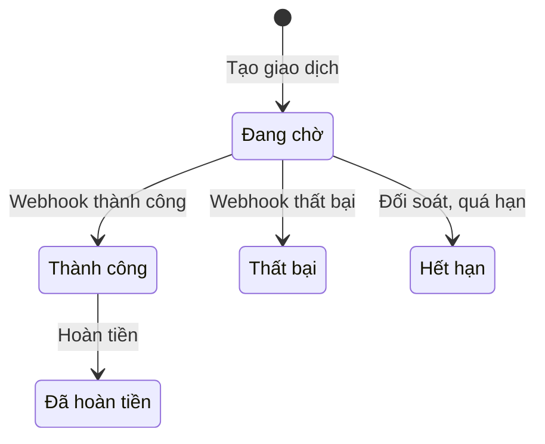

# Trạng thái đơn hàng và thanh toán

Vì sao phải dùng trạng thái: xem [Thanh toán là quy trình bất đồng bộ](../04-explanation/thanh-toan-bat-dong-bo.md).

## Đơn hàng (Order)

| Từ | Sự kiện | Đến | Ai kích hoạt | Tác động phụ |
|---|---|---|---|---|
| (mới) | Tạo đơn | `pending_payment` | Khách qua API | Giữ tồn kho |
| `pending_payment` | Thanh toán thành công | `paid` | Webhook hoặc đối soát | Trừ tồn kho, ghi outbox gửi email |
| `pending_payment` | Hết hạn, thanh toán thất bại | `cancelled` | Job nền hoặc webhook | Nhả tồn kho |
| `paid` | Bàn giao vận chuyển | `shipping` | Nhân viên kho | |
| `shipping` | Giao thành công | `completed` | Đơn vị vận chuyển | |
| `paid` | Hoàn tiền | `refunded` | Nhân viên hỗ trợ | Gọi cổng hoàn tiền |

## Thanh toán (Payment)

| Từ | Đến được | Không bao giờ |
|---|---|---|
| `pending` | `succeeded`, `failed`, `expired` | |
| `succeeded` | `refunded` | `failed`, `pending` |
| `failed`, `expired` | (kết thúc) | `succeeded` qua cùng bản ghi; khách thử lại thì tạo bản ghi mới |

Bước chuyển không hợp lệ bị từ chối và ghi log cảnh báo, không ghi đè. Một số cổng tách thêm bước giữ tiền và thu tiền (authorize, capture), xem [L3](../00-lo-trinh/l3-production.md).
