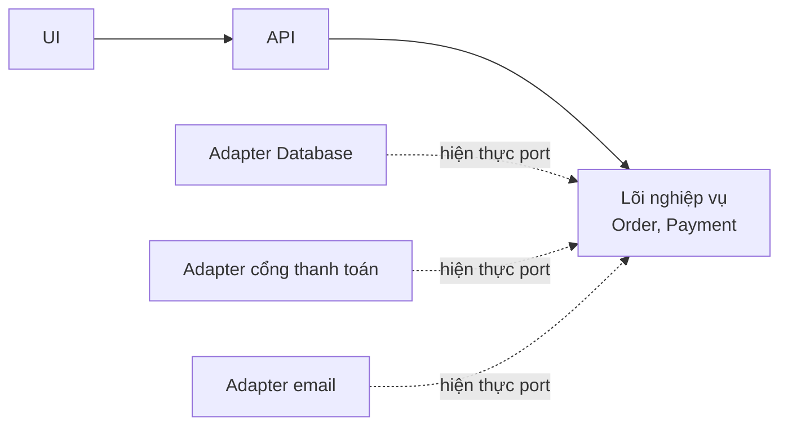

# Chiều phụ thuộc quan trọng hơn số tầng

## Kiến trúc theo layer

Trong kiến trúc theo layer, tầng trên gọi tầng dưới:

`UI → API (controller) → Service → Repository → Database`

Mỗi tầng chỉ nên biết tầng ngay dưới nó. Controller không viết SQL, UI không tự tính tiền.

## Nguyên tắc cốt lõi

**Quy tắc nghiệp vụ không nên phụ thuộc vào chi tiết kỹ thuật.** Hàm tính tiền không cần biết bạn dùng PostgreSQL hay MySQL, dùng VNPay hay Stripe. Nhờ vậy bạn đổi được database hay cổng thanh toán mà không phải viết lại quy tắc, và test được quy tắc mà không cần database thật.

## Repository là một lựa chọn, không phải quy luật

Repository gom việc đọc ghi dữ liệu vào một chỗ. Nhiều dự án quy ước chỉ lớp này được chạm database. Đây là lựa chọn phổ biến và hữu ích, nhưng không bắt buộc: dự án nhỏ có thể gọi ORM thẳng trong service mà vẫn ổn. Quyết định nào cũng nên được ghi lại bằng [ADR](../decisions/README.md).

## Ports and adapters

Các kiến trúc như **ports and adapters** (còn gọi là hexagonal) hay **clean architecture** đảo chiều phụ thuộc:

- Lõi nghiệp vụ tự định nghĩa giao diện nó cần, gọi là *port*. Ví dụ: "lưu đơn", "tạo giao dịch thanh toán".
- Database, cổng thanh toán, dịch vụ email là *adapter* cắm vào port đó.
- Đổi cổng thanh toán chỉ cần viết adapter mới, lõi không đổi.

Ở L1, hiểu nguyên tắc là đủ. L2 sẽ áp dụng vào module Payment.
