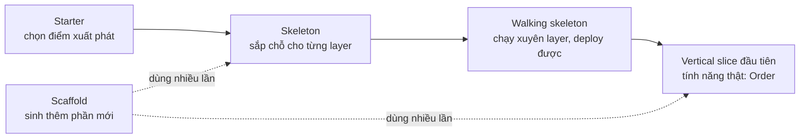

# Starter, scaffold, skeleton: khởi tạo dự án

Ba từ này hay được dùng lẫn cho nhau khi bắt đầu một dự án, nhưng chúng là ba thứ khác nhau. Thêm một khái niệm thứ tư rất đáng biết: **walking skeleton**.

## So sánh

| | Starter | Scaffold | Skeleton | Walking skeleton |
|---|---|---|---|---|
| Là gì | Dự án mẫu dựng sẵn | Công cụ hoặc lệnh sinh file theo mẫu | Khung thư mục và file gần như rỗng | Khung nhỏ nhất **chạy được** xuyên mọi layer, đã deploy |
| Dùng mấy lần | Một lần, lúc bắt đầu | Nhiều lần, mỗi khi thêm một phần | Một lần | Một lần, rồi lớn dần thành sản phẩm |
| Kết quả | Một repo có cấu trúc, thư viện, cấu hình | Thêm file cho một phần (model, controller, migration) | Chỗ trống cho từng layer | `/health` đi qua API và database, CI chạy, staging có link |
| Ví dụ | Starter chính thức của framework | Lệnh sinh CRUD cho `Product` | `controller/`, `service/`, `repository/` rỗng | Giai đoạn P0 của [roadmap mẫu](../02-how-to/lap-roadmap-mvp.md) |
| Rủi ro | Kéo theo thư viện và quyết định bạn không cần | Sinh code không theo quy ước của dự án | Trông như đã có tiến độ nhưng chưa chứng minh được gì | Ít rủi ro nhất, nhưng cần kỷ luật để giữ nó nhỏ |

## Chúng nối với nhau thế nào

Mục tiêu của giai đoạn khởi tạo là **walking skeleton**, không phải skeleton. Một bộ khung đã deploy được, CI đã chạy, database đã kết nối, sẽ lộ sớm các vấn đề về hạ tầng, quyền truy cập, biến môi trường. Một bộ khung chỉ có thư mục rỗng thì không lộ được gì.

## Trong thời AI

AI dựng starter và scaffold rất nhanh, nên dễ có cảm giác đã đi được nửa đường. Bốn điều cần để ý:

1. **Ưu tiên starter chính thức** của framework hơn starter do AI tự nghĩ ra. AI hay chọn thư viện cũ hoặc thư viện không ai bảo trì.
2. **Đọc lock file và danh sách thư viện** trước commit đầu tiên. Mỗi thư viện là một thứ phải cập nhật và vá lỗi bảo mật về sau.
3. **Scaffold theo quy ước của dự án.** Đưa [quy ước](../03-reference/quy-uoc.md) và [AGENTS.md](../06-ai/agents-md.md) vào ngữ cảnh, để code sinh ra đặt đúng layer và đúng tên.
4. **Ghi lựa chọn khởi tạo bằng [ADR](../decisions/README.md)**: framework, cấu trúc, database. Đây là những quyết định khó đảo ngược nhất.

## Checklist chọn starter

- [ ] Còn được bảo trì: có cập nhật trong vài tháng gần đây.
- [ ] Dùng phiên bản framework hiện hành.
- [ ] License cho phép dùng thương mại.
- [ ] Ít thư viện phụ thuộc, không có thứ bạn chưa cần.
- [ ] Cấu trúc khớp với kiến trúc đã chọn ([ADR 0001](../decisions/0001-monolith-theo-layer.md)).
- [ ] Có sẵn lint, format, test, hoặc thêm vào dễ dàng.

## Áp vào case study

P0 của roadmap mẫu là walking skeleton: khởi tạo từ starter chính thức, sắp layer theo ADR 0001, một endpoint `/health` đọc được database, một migration đầu tiên, CI chạy lint và test, tự deploy lên staging. Từ P1 trở đi, mỗi giai đoạn thêm một vertical slice lên bộ khung đó.
