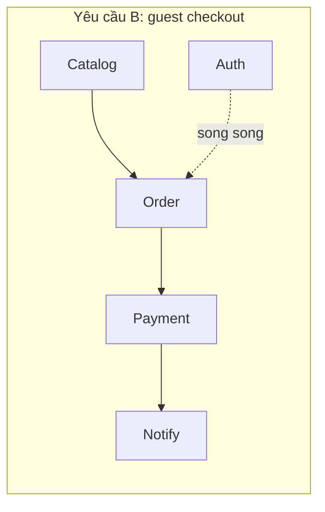

# Phụ thuộc đến từ yêu cầu, không phải từ kiến trúc

Một lỗi thường gặp là coi "Auth → Order → Payment" như thứ tự bắt buộc. Thực ra thứ tự làm việc xuất phát từ **yêu cầu nghiệp vụ**.

## Cùng một hệ thống, hai yêu cầu

| | Yêu cầu A: bắt buộc đăng nhập | Yêu cầu B: cho mua không cần đăng nhập |
|---|---|---|
| Order cần gì | Catalog và Auth | Chỉ Catalog |
| Auth làm khi nào | Trước Order | Song song, dùng cho trang "đơn của tôi" |
| Thứ tự | Catalog, Auth, Order, Payment | Catalog, Order, Payment; Auth song song |

Case study chọn **yêu cầu B**, ghi trong [ADR 0002](../decisions/0002-guest-checkout.md).

## Cách làm

1. Viết yêu cầu ra trước, kể cả những thứ không làm.
2. Với mỗi module, hỏi: module này cần dữ liệu hay hành vi gì từ module khác **theo yêu cầu**?
3. Vẽ phụ thuộc từ câu trả lời, rồi mới xếp roadmap.
