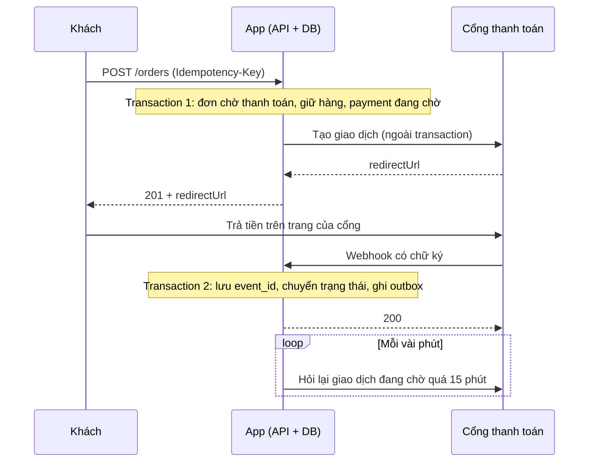

# Thanh toán là một quy trình bất đồng bộ, không phải một lần gọi hàm

Cổng thanh toán nằm ngoài database của bạn, nên **không có transaction nào bao trùm cả hai**. Khách có thể đóng trình duyệt, mạng có thể chập chờn, webhook có thể đến trễ hoặc đến hai lần. Vì vậy đơn hàng và thanh toán được quản lý bằng [trạng thái](../03-reference/trang-thai.md).

## Ranh giới transaction

| Lúc | Trong hay ngoài transaction | Việc làm |
|---|---|---|
| Tạo đơn | **Trong 1 DB transaction** | Tạo đơn "chờ thanh toán", lưu món hàng kèm giá lúc mua, giữ tồn kho có điều kiện, tạo bản ghi thanh toán "đang chờ" gắn idempotency key |
| Gọi cổng | **Ngoài transaction** | Lấy đường dẫn thanh toán. Hết thời gian chờ không có nghĩa là thất bại: giữ "đang chờ" và đợi webhook hoặc đối soát |
| Nhận webhook | **Trong 1 DB transaction** | Lưu event_id (trùng thì bỏ qua), chuyển trạng thái thanh toán và đơn nếu hợp lệ, ghi sự kiện "gửi email" vào outbox |

## Toàn bộ luồng

## Sáu nguyên tắc bắt buộc

1. **Idempotency.** Cùng một yêu cầu gửi lại nhiều lần chỉ tạo ra một kết quả. Dùng Idempotency-Key cho tạo đơn và tạo thanh toán.
2. **Chống webhook trùng.** Lưu event_id với ràng buộc duy nhất. Gặp lại thì trả 200 và bỏ qua.
3. **Chỉ chuyển trạng thái hợp lệ.** "Thất bại" đến sau "Thành công" thì bị từ chối và ghi log, không ghi đè.
4. **Kiểm chữ ký.** Chỉ tin webhook có chữ ký đúng. Không tin trạng thái mà trình duyệt gửi về qua đường dẫn quay lại.
5. **Đối soát.** Job định kỳ hỏi lại cổng các giao dịch "đang chờ" quá lâu, và đối chiếu báo cáo cuối ngày của cổng.
6. **Nhất quán sau cùng.** Có lúc đơn và cổng chưa khớp. Thiết kế để hệ thống tự khớp lại, và giao diện nói thật "đang xử lý".

Quyết định này được ghi trong [ADR 0003](../decisions/0003-webhook-xac-nhan-thanh-toan.md). L3 sẽ nói thêm về authorize và capture, outbox và inbox, hoàn tiền một phần.
