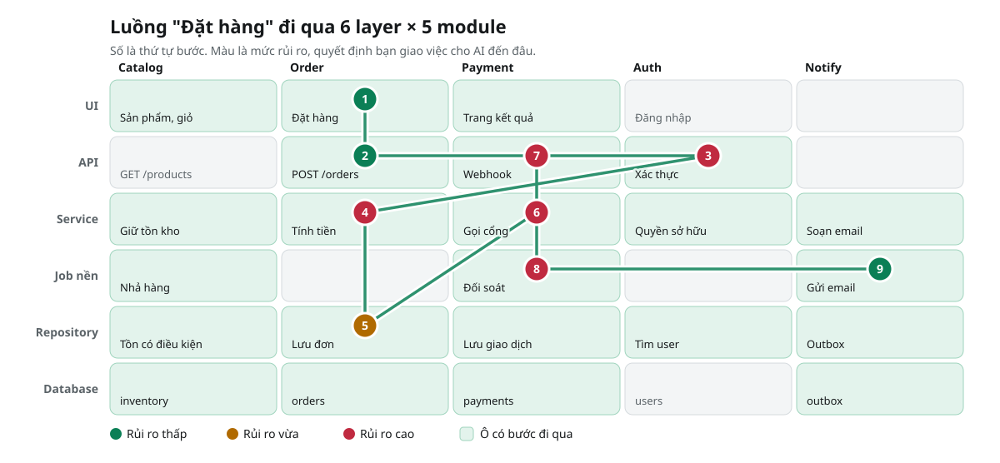
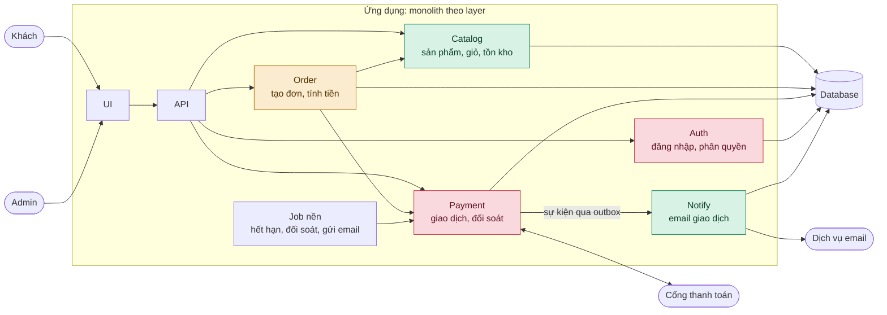
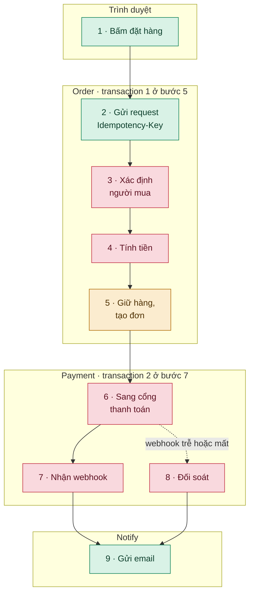
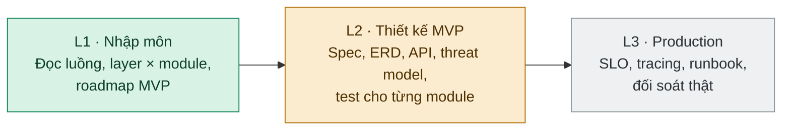
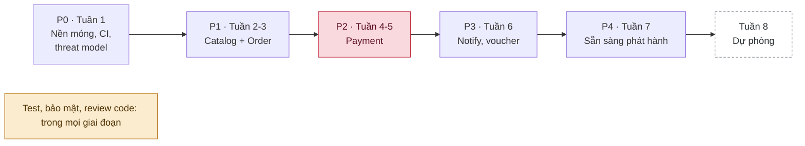
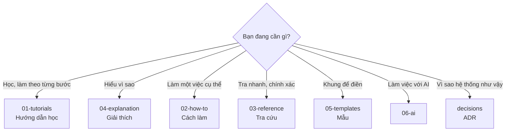

<!--
---
id: trang-chu
title: "dev-handbook"
type: overview
level: chung
status: done
updated: 2026-11-25
review_by: 2027-02-25
owner: "(điền tên)"
---
-->

# dev-handbook

Tài liệu nhập môn cho Dev FullStack thời AI. Một tính năng như "Đặt hàng" đi qua nhiều layer và module. Biết nó đi qua đâu và rủi ro nằm ở chỗ nào thì mới lập kế hoạch đúng và giao việc cho AI đúng.

**Xem online:** https://nguyentan510.github.io/dev-handbook/

<picture>
  <source media="(prefers-color-scheme: dark)" srcset="assets/hero-dark.svg">
  
</picture>

> Đây không phải blueprint production. Case study app bán hàng và mọi con số (thời gian, SLO, ngưỡng) là ví dụ minh họa.

## Hệ thống trong case study

Một app bán hàng online cho shop quà tặng: monolith chia theo layer, năm module, nói chuyện với hai dịch vụ bên ngoài. Màu là mức rủi ro của module.

## Luồng đặt hàng theo module

Bước 5 và bước 7 mỗi bước là một DB transaction. Gọi cổng thanh toán nằm ngoài transaction, nên cần webhook và đối soát. Chi tiết: [Luồng "Đặt hàng"](01-tutorials/luong-dat-hang.md).

## Lộ trình học

Xanh: hoàn thành. Vàng: đang viết (4/5 module đã có bản nháp). Xám: mới có khung.

## Roadmap mẫu 8 tuần

Cắt dọc theo module, mỗi giai đoạn kết thúc bằng một thứ demo được. Chi tiết: [Lập roadmap MVP](02-how-to/lap-roadmap-mvp.md).

## Tìm đúng trang

## Ba cấp độ

| Cấp | Tên | Học xong làm được gì | Trạng thái |
|---|---|---|---|
| L1 | [Nhập môn](00-lo-trinh/l1-nhap-mon.md) | Đọc luồng một tính năng, phân biệt layer, module, domain, lập roadmap MVP | Hoàn thành |
| L2 | [Thiết kế MVP thực tế](00-lo-trinh/l2-thiet-ke-mvp.md) | Tự viết spec, ERD, API contract, threat model, test strategy cho một module | Đang viết: 4/5 module có bản nháp |
| L3 | [Production và vận hành](00-lo-trinh/l3-production.md) | Đưa hệ thống có thanh toán thật lên production an toàn | Khung |

## Bắt đầu từ đâu

- **Người mới:** đọc [Lộ trình L1](00-lo-trinh/l1-nhap-mon.md), rồi đi theo [Luồng đặt hàng](01-tutorials/luong-dat-hang.md).
- **Cần tra một từ:** [Bảng thuật ngữ](03-reference/thuat-ngu.md).
- **Đang lập kế hoạch:** [Lập roadmap MVP](02-how-to/lap-roadmap-mvp.md), rồi tự chấm bằng [8 tiêu chí](03-reference/tieu-chi-ke-hoach.md).
- **Đang vibe code:** [Giao việc cho AI](02-how-to/giao-viec-cho-ai.md) và [Review code AI viết](02-how-to/review-code-ai.md).
- **Bắt đầu thiết kế một module:** [Khuôn module 10 mục](05-templates/khuon-module.md).

## Tài liệu được chia thế nào

Mỗi trang chỉ thuộc một loại, theo cách chia của Diátaxis. Trộn nhiều loại vào một trang làm người mới thấy rối, còn người cần tra cứu thì không tìm được.

| Thư mục | Loại | Dùng khi |
|---|---|---|
| `00-lo-trinh` | Lộ trình | Muốn biết học gì, theo thứ tự nào |
| `01-tutorials` | Hướng dẫn học | Học qua case study, làm theo từng bước |
| `02-how-to` | Cách làm | Cần làm một việc cụ thể |
| `03-reference` | Tra cứu | Cần tra nhanh, chính xác |
| `04-explanation` | Giải thích | Muốn hiểu vì sao |
| `05-templates` | Mẫu | Cần khung để điền |
| `06-ai` | Làm việc với AI | Nguyên tắc, file ngữ cảnh, prompt |
| `decisions` | Quyết định (ADR) | Muốn biết vì sao hệ thống được làm như vậy |

## Thông tin tài liệu

| | |
|---|---|
| Phiên bản | 1.5 ([nhật ký thay đổi](CHANGELOG.md)) |
| Người đọc | Người mới, junior, người vibe code, dev chuyển sang fullstack |
| Case study | App bán hàng online của một shop quà tặng (ví dụ) |
| Cách đóng góp | [Cách viết và bảo trì tài liệu](CONTRIBUTING.md) |
